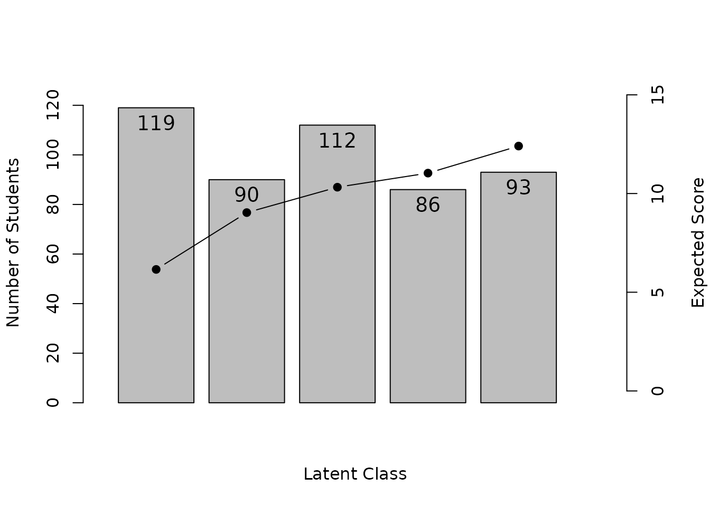
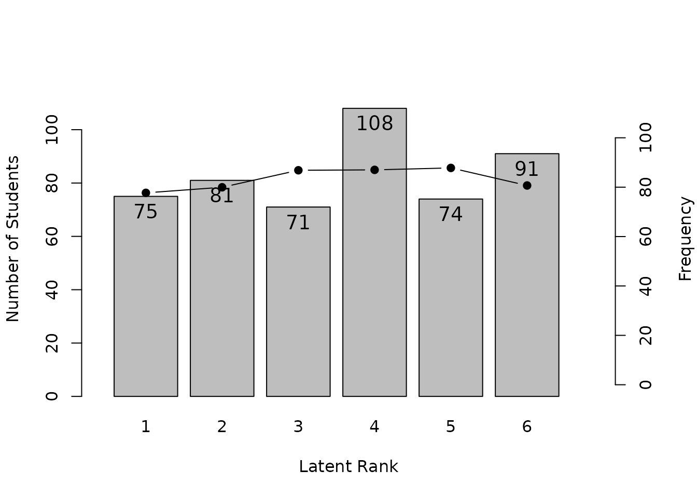

# Latent Class and Rank Analysis

> **Note**: Some computationally intensive examples below are shown with
> `eval=FALSE` to keep CRAN build times short. For full rendered output,
> see the [pkgdown
> site](https://kosugitti.github.io/exametrika/articles/latent-class-rank.html).

``` r

library(exametrika)
```

## Latent Class Analysis (LCA)

LCA classifies examinees into unordered latent classes. Specify the
dataset and the number of classes.

``` r

LCA(J15S500, ncls = 5)
#> 
#> Item Reference Profile
#>          IRP1   IRP2   IRP3   IRP4  IRP5
#> Item01 0.5899 0.6616 0.7723 0.8528 0.884
#> Item02 0.5174 0.7102 0.8282 0.8863 0.871
#> Item03 0.5913 0.6112 0.8905 0.7196 0.839
#> Item04 0.3894 0.8671 0.8214 0.8657 1.000
#> Item05 0.6729 0.6759 1.0000 0.7718 0.920
#> Item06 0.6261 0.8857 0.9478 1.0000 0.903
#> Item07 0.3530 0.7209 0.7978 0.8818 0.891
#> Item08 0.3087 0.5911 0.5724 0.9172 0.609
#> Item09 0.2856 0.5414 0.2028 0.0993 0.692
#> Item10 0.5334 0.4995 0.8109 0.6898 0.800
#> Item11 0.0977 0.0203 0.0437 0.6450 0.678
#> Item12 0.0324 0.2904 0.1232 0.2821 0.684
#> Item13 0.2753 0.5690 0.9059 0.6655 0.811
#> Item14 0.4745 0.7017 0.7876 0.9101 1.000
#> Item15 0.4076 0.6879 0.8160 0.8471 0.824
#> 
#> Test Profile
#>                               Class 1 Class 2 Class 3 Class 4 Class 5
#> Test Reference Profile          6.155   9.034  10.321  11.034  12.405
#> Latent Class Distribution     119.000  90.000 112.000  86.000  93.000
#> Class Membership Distribution 112.595  99.087  98.338  93.199  96.781
#> 
#> Item Fit Indices
#>        model_log_like bench_log_like null_log_like model_Chi_sq null_Chi_sq
#> Item01       -265.973       -240.190      -283.343       51.567      86.307
#> Item02       -252.897       -235.436      -278.949       34.921      87.025
#> Item03       -274.312       -260.906      -293.598       26.811      65.383
#> Item04       -197.018       -192.072      -265.962        9.892     147.780
#> Item05       -210.739       -206.537      -247.403        8.404      81.732
#> Item06       -160.728       -153.940      -198.817       13.577      89.755
#> Item07       -248.567       -228.379      -298.345       40.377     139.933
#> Item08       -295.127       -293.225      -338.789        3.804      91.127
#> Item09       -275.194       -300.492      -327.842      -50.596      54.700
#> Item10       -300.308       -288.198      -319.850       24.219      63.303
#> Item11       -184.992       -224.085      -299.265      -78.187     150.360
#> Item12       -228.335       -214.797      -293.598       27.076     157.603
#> Item13       -270.952       -262.031      -328.396       17.843     132.730
#> Item14       -217.326       -204.953      -273.212       24.746     136.519
#> Item15       -269.453       -254.764      -302.847       29.378      96.166
#>        model_df null_df   NFI   RFI   IFI   TLI   CFI RMSEA     AIC     CAIC
#> Item01        9      13 0.403 0.137 0.449 0.161 0.419 0.097  33.567  -13.365
#> Item02        9      13 0.599 0.420 0.668 0.494 0.650 0.076  16.921  -30.011
#> Item03        9      13 0.590 0.408 0.684 0.509 0.660 0.063   8.811  -38.120
#> Item04        9      13 0.933 0.903 0.994 0.990 0.993 0.014  -8.108  -55.039
#> Item05        9      13 0.897 0.851 1.000 1.000 1.000 0.000  -9.596  -56.527
#> Item06        9      13 0.849 0.782 0.943 0.914 0.940 0.032  -4.423  -51.355
#> Item07        9      13 0.711 0.583 0.760 0.643 0.753 0.084  22.377  -24.554
#> Item08        9      13 0.958 0.940 1.000 1.000 1.000 0.000 -14.196  -61.127
#> Item09        9      13 1.000 1.000 1.000 1.000 1.000 0.000 -68.596 -115.528
#> Item10        9      13 0.617 0.447 0.720 0.563 0.697 0.058   6.219  -40.712
#> Item11        9      13 1.000 1.000 1.000 1.000 1.000 0.000 -96.187 -143.118
#> Item12        9      13 0.828 0.752 0.878 0.819 0.875 0.063   9.076  -37.856
#> Item13        9      13 0.866 0.806 0.929 0.893 0.926 0.044  -0.157  -47.089
#> Item14        9      13 0.819 0.738 0.877 0.816 0.873 0.059   6.746  -40.186
#> Item15        9      13 0.695 0.559 0.766 0.646 0.755 0.067  11.378  -35.553
#>             BIC
#> Item01   -4.365
#> Item02  -21.011
#> Item03  -29.120
#> Item04  -46.039
#> Item05  -47.527
#> Item06  -42.355
#> Item07  -15.554
#> Item08  -52.127
#> Item09 -106.528
#> Item10  -31.712
#> Item11 -134.118
#> Item12  -28.856
#> Item13  -38.089
#> Item14  -31.186
#> Item15  -26.553
#> 
#> Model Fit Indices
#> Number of Latent class: 5
#> Number of EM cycle: 337 
#>                    value
#> model_log_like -3651.921
#> bench_log_like -3560.005
#> null_log_like  -4350.217
#> model_Chi_sq     183.832
#> null_Chi_sq     1580.424
#> model_df         135.000
#> null_df          195.000
#> NFI                0.884
#> RFI                0.832
#> IFI                0.966
#> TLI                0.949
#> CFI                0.965
#> RMSEA              0.027
#> AIC              -86.168
#> CAIC            -790.140
#> BIC             -655.140
#> 
#> Variational Fit
#>                      value
#> ELBO             -4118.164
#> log_lik_marginal -4118.164
#> entropy_class      338.476
#> ICL               9064.738
```

The Class Membership Matrix indicates which latent class each examinee
belongs to:

``` r

result.LCA <- LCA(J15S500, ncls = 5)
head(result.LCA$Students)
#>            Membership 1 Membership 2 Membership 3 Membership 4 Membership 5
#> Student001 0.7281646596  0.012201215  0.226647654 3.298647e-02 3.051500e-12
#> Student002 0.0220667934  0.087019999  0.830774343 6.013876e-02 1.075088e-07
#> Student003 0.0170563995  0.054112134  0.879768216 2.099456e-02 2.806869e-02
#> Student004 0.0010508169  0.223167062  0.203772041 3.286839e-01 2.433262e-01
#> Student005 0.9407941768  0.053323634  0.004873676 1.806795e-08 1.008496e-03
#> Student006 0.0002372348  0.002526937  0.029811035 8.550547e-01 1.123701e-01
#>            Estimate
#> Student001        1
#> Student002        3
#> Student003        3
#> Student004        4
#> Student005        1
#> Student006        4
```

### LCA Plot Types

- **IRP**: Item Reference Profile
- **CMP**: Class Membership Profile
- **TRP**: Test Reference Profile
- **LCD**: Latent Class Distribution

``` r

plot(result.LCA, type = "IRP", items = 1:6, nc = 2, nr = 3)
```


``` r

plot(result.LCA, type = "CMP", students = 1:9, nc = 3, nr = 3)
```


``` r

plot(result.LCA, type = "TRP")
```



``` r

plot(result.LCA, type = "LCD")
```


## Latent Rank Analysis (LRA)

LRA is similar to LCA but assumes an ordering among the latent classes
(ranks). Specify the dataset and the number of ranks.

``` r

LRA(J15S500, nrank = 6)
#> estimating method is  isotonic 
#> Item Reference Profile
#>          IRP1   IRP2   IRP3   IRP4  IRP5  IRP6
#> Item01 0.4582 0.7484 0.7484 0.7484 0.839 0.914
#> Item02 0.5601 0.5601 0.8048 0.8048 0.883 0.883
#> Item03 0.5996 0.5996 0.7590 0.7590 0.759 0.866
#> Item04 0.4668 0.4668 0.8949 0.8949 0.895 0.995
#> Item05 0.5593 0.8284 0.8284 0.8284 0.828 0.936
#> Item06 0.6196 0.7691 0.9416 0.9416 0.942 0.942
#> Item07 0.4112 0.4112 0.7402 0.8959 0.896 0.896
#> Item08 0.3485 0.3485 0.6006 0.7315 0.732 0.732
#> Item09 0.3149 0.3149 0.3149 0.3149 0.315 0.619
#> Item10 0.4438 0.6344 0.6940 0.6940 0.722 0.765
#> Item11 0.0816 0.0816 0.0816 0.0816 0.688 0.688
#> Item12 0.0653 0.0653 0.2193 0.2193 0.219 0.859
#> Item13 0.2228 0.4902 0.7527 0.7527 0.753 0.788
#> Item14 0.2894 0.7760 0.7760 0.7760 0.933 1.000
#> Item15 0.3830 0.5188 0.8164 0.8164 0.816 0.845
#> 
#> Item Reference Profile Indices
#>        Alpha     A Beta     B Gamma C
#> Item01     1 0.290    1 0.458     0 0
#> Item02     2 0.245    1 0.560     0 0
#> Item03     2 0.159    1 0.600     0 0
#> Item04     2 0.428    1 0.467     0 0
#> Item05     1 0.269    1 0.559     0 0
#> Item06     2 0.173    1 0.620     0 0
#> Item07     2 0.329    1 0.411     0 0
#> Item08     2 0.252    3 0.601     0 0
#> Item09     5 0.304    6 0.619     0 0
#> Item10     1 0.191    1 0.444     0 0
#> Item11     4 0.607    5 0.688     0 0
#> Item12     5 0.640    3 0.219     0 0
#> Item13     1 0.267    2 0.490     0 0
#> Item14     1 0.487    1 0.289     0 0
#> Item15     2 0.298    2 0.519     0 0
#> 
#> Test Profile
#>                              Rank 1 Rank 2 Rank 3  Rank 4 Rank 5 Rank 6
#> Test Reference Profile        5.824  7.613  9.973  10.259 11.219 12.727
#> Latent Rank Distribution     75.000 81.000 71.000 108.000 74.000 91.000
#> Rank Membership Distribution 77.701 79.962 86.850  87.008 87.794 80.684
#> 
#> Item Fit Indices
#>        model_log_like bench_log_like null_log_like model_Chi_sq null_Chi_sq
#> Item01       -259.076       -240.190      -283.343       37.774      86.307
#> Item02       -254.770       -235.436      -278.949       38.667      87.025
#> Item03       -282.423       -260.906      -293.598       43.033      65.383
#> Item04       -199.587       -192.072      -265.962       15.031     147.780
#> Item05       -229.024       -206.537      -247.403       44.974      81.732
#> Item06       -170.971       -153.940      -198.817       34.063      89.755
#> Item07       -241.896       -228.379      -298.345       27.035     139.933
#> Item08       -308.978       -293.225      -338.789       31.505      91.127
#> Item09       -314.833       -300.492      -327.842       28.681      54.700
#> Item10       -308.795       -288.198      -319.850       41.194      63.303
#> Item11       -198.254       -224.085      -299.265      -51.663     150.360
#> Item12       -208.499       -214.797      -293.598      -12.595     157.603
#> Item13       -284.708       -262.031      -328.396       45.355     132.730
#> Item14       -203.449       -204.953      -273.212       -3.008     136.519
#> Item15       -266.695       -254.764      -302.847       23.862      96.166
#>        model_df null_df   NFI   RFI   IFI   TLI   CFI RMSEA     AIC     CAIC
#> Item01       10      13 0.562 0.431 0.636 0.507 0.621 0.075  17.774  -34.373
#> Item02       11      13 0.556 0.475 0.636 0.558 0.626 0.071  16.667  -40.694
#> Item03       11      13 0.342 0.222 0.411 0.277 0.388 0.076  21.033  -36.327
#> Item04       11      13 0.898 0.880 0.971 0.965 0.970 0.027  -6.969  -64.330
#> Item05       11      13 0.450 0.350 0.520 0.416 0.506 0.079  22.974  -34.387
#> Item06       11      13 0.620 0.551 0.707 0.645 0.700 0.065  12.063  -45.297
#> Item07       11      13 0.807 0.772 0.876 0.851 0.874 0.054   5.035  -52.326
#> Item08       11      13 0.654 0.591 0.744 0.690 0.738 0.061   9.505  -47.856
#> Item09       12      13 0.476 0.432 0.609 0.567 0.600 0.053   4.681  -57.894
#> Item10        9      13 0.349 0.060 0.407 0.076 0.360 0.085  23.194  -23.738
#> Item11       12      13 1.000 1.000 1.000 1.000 1.000 0.000 -75.663 -138.238
#> Item12       11      13 1.000 1.000 1.000 1.000 1.000 0.000 -34.595  -91.956
#> Item13       10      13 0.658 0.556 0.712 0.616 0.705 0.084  25.355  -26.791
#> Item14       10      13 1.000 1.000 1.000 1.000 1.000 0.000 -23.008  -75.154
#> Item15       10      13 0.752 0.677 0.839 0.783 0.833 0.053   3.862  -48.284
#>             BIC
#> Item01  -24.373
#> Item02  -29.694
#> Item03  -25.327
#> Item04  -53.330
#> Item05  -23.387
#> Item06  -34.297
#> Item07  -41.326
#> Item08  -36.856
#> Item09  -45.894
#> Item10  -14.738
#> Item11 -126.238
#> Item12  -80.956
#> Item13  -16.791
#> Item14  -65.154
#> Item15  -38.284
#> 
#> Model Fit Indices
#> Number of Latent rank: 6
#> Number of EM cycle: 65 
#>                    value
#> model_log_like -3731.959
#> bench_log_like -3560.005
#> null_log_like  -4350.217
#> model_Chi_sq     343.908
#> null_Chi_sq     1580.424
#> model_df         161.000
#> null_df          195.000
#> NFI                0.782
#> RFI                0.736
#> IFI                0.871
#> TLI                0.840
#> CFI                0.868
#> RMSEA              0.048
#> AIC               21.908
#> CAIC            -817.644
#> BIC             -656.644
#> 
#> Variational Fit
#>                      value
#> ELBO             -4131.841
#> log_lik_marginal -4131.841
#> entropy_class      495.998
#> ICL               9145.928
```

Rank membership probabilities and rank-up/rank-down odds are calculated:

``` r

result.LRA <- LRA(J15S500, nrank = 6)
head(result.LRA$Students)
#>            Membership 1 Membership 2 Membership 3 Membership 4 Membership 5
#> Student001  0.373362828  0.428218832   0.11222243   0.03023517  0.055960736
#> Student002  0.020038540  0.080823095   0.57927688   0.28286515  0.036996142
#> Student003  0.006211982  0.213060043   0.54320920   0.14635238  0.076437420
#> Student004  0.001004123  0.009115719   0.19879539   0.29307173  0.133726701
#> Student005  0.252721804  0.727486696   0.01394724   0.00375769  0.001962579
#> Student006  0.000130071  0.002051624   0.04590205   0.06767055  0.766752034
#>            Membership 6 Estimate Rank-Up Odds Rank-Down Odds
#> Student001 6.586004e-09        2   0.26206795     0.87189726
#> Student002 1.929370e-07        3   0.48830733     0.13952412
#> Student003 1.472897e-02        3   0.26942176     0.39222466
#> Student004 3.642863e-01        6           NA     0.36709228
#> Student005 1.239901e-04        2   0.01917182     0.34739028
#> Student006 1.174937e-01        5   0.15323555     0.08825611
```

``` r

plot(result.LRA, type = "IRP", items = 1:6, nc = 2, nr = 3)
```


``` r

plot(result.LRA, type = "RMP", students = 1:9, nc = 3, nr = 3)
```


``` r

plot(result.LRA, type = "TRP")
```


``` r

plot(result.LRA, type = "LRD")
```



## Classifying New Respondents with `predict()`

Once a model is fitted,
[`predict()`](https://rdrr.io/r/stats/predict.html) assigns new
respondents to its classes or ranks. The estimated parameters are held
fixed and one E-step is run on the new responses, so the new respondents
do not change the model. This is useful when the model is built on one
group and applied to another, for example a later cohort that took the
same test.

Here the model is fitted to the first 400 examinees and then used to
classify the remaining 100.

``` r

X <- J15S500$U
X[J15S500$Z == 0] <- NA
fit <- LRA(dataFormat(X[1:400, ]), nrank = 6)
pred <- predict(fit, X[401:500, ])
pred
#> Prediction from a LRA fit: 100 respondents, 6 ranks
#> 
#> Latent rank distribution of the estimates:
#> Rank1 Rank2 Rank3 Rank4 Rank5 Rank6 
#>    13    20    17    19    16    15
head(round(pred$Membership, 3))
#>          Rank1 Rank2 Rank3 Rank4 Rank5 Rank6
#> Student1 0.000 0.003 0.048 0.057 0.163 0.729
#> Student2 0.323 0.410 0.138 0.128 0.001 0.000
#> Student3 0.006 0.150 0.312 0.216 0.127 0.189
#> Student4 0.000 0.007 0.098 0.573 0.275 0.047
#> Student5 0.071 0.090 0.627 0.155 0.058 0.000
#> Student6 0.012 0.116 0.417 0.288 0.159 0.008
head(pred$Estimate)
#> Student1 Student2 Student3 Student4 Student5 Student6 
#>        6        2        3        4        3        3
```

`newdata` can be a matrix or data frame with the items in columns, or an
object made by
[`dataFormat()`](https://kosugitti.github.io/exametrika/reference/dataFormat.md).
Items are matched by name, so the columns may come in any order and
extra columns are ignored; a missing item is an error. Missing responses
(`NA`, or the codes given in `na`) are simply left out of the
likelihood, so a respondent who answered only some items still gets a
membership. Polytomous responses must use the coding of the fitted data;
a category that the fitted data never used for an item cannot be scored
and is treated as missing, with a warning.

`pred$log_lik` holds each respondent’s log-likelihood under the model.
Summed over held-out respondents, it gives a predictive criterion for
comparing models fitted to the same training data:

``` r

fit4 <- LRA(dataFormat(X[1:400, ]), nrank = 4)
c(
  nrank4 = sum(predict(fit4, X[401:500, ])$log_lik),
  nrank6 = sum(pred$log_lik)
)
#>    nrank4    nrank6 
#> -831.3531 -832.0329
```

On the data a model was fitted to,
[`predict()`](https://rdrr.io/r/stats/predict.html) reproduces the
memberships stored in the fit. It works the same way for
[`LCA()`](https://kosugitti.github.io/exametrika/reference/LCA.md) and
for
[`Biclustering()`](https://kosugitti.github.io/exametrika/reference/Biclustering.md)
/ Ranklustering, with binary, nominal, ordinal and rated data; for
biclustering the field memberships of the items are held fixed as well.

## LRA for Ordinal Data

LRA can also handle ordinal scale data. The `mic` option enforces
monotonic increasing constraints.

``` r

result.LRAord <- LRA(J15S3810, nrank = 3, mic = TRUE)
```

Score-rank relationship visualizations:

``` r

plot(result.LRAord, type = "ScoreFreq")
plot(result.LRAord, type = "ScoreRank")
```

Item-rank relationship plots:

- **ICBR**: Item Category Boundary Reference – cumulative probability
  curves for each category threshold
- **ICRP**: Item Category Response Profile – probability of each
  response category across ranks

``` r

plot(result.LRAord, type = "ICBR", items = 1:4, nc = 2, nr = 2)
plot(result.LRAord, type = "ICRP", items = 1:4, nc = 2, nr = 2)
```

Rank membership profiles for individual examinees:

``` r

plot(result.LRAord, type = "RMP", students = 1:9, nc = 3, nr = 3)
```

## LRA for Rated/Nominal Data

For multiple-choice tests (nominal scale), LRA can analyze response
patterns including distractor choices.

``` r

result.LRArated <- LRA(J35S5000, nrank = 10, mic = TRUE)
```

``` r

plot(result.LRArated, type = "ScoreFreq")
plot(result.LRArated, type = "ScoreRank")
```

``` r

plot(result.LRArated, type = "ICRP", items = 1:4, nc = 2, nr = 2)
```

## Reference

Shojima, K. (2022). *Test Data Engineering*. Springer.
